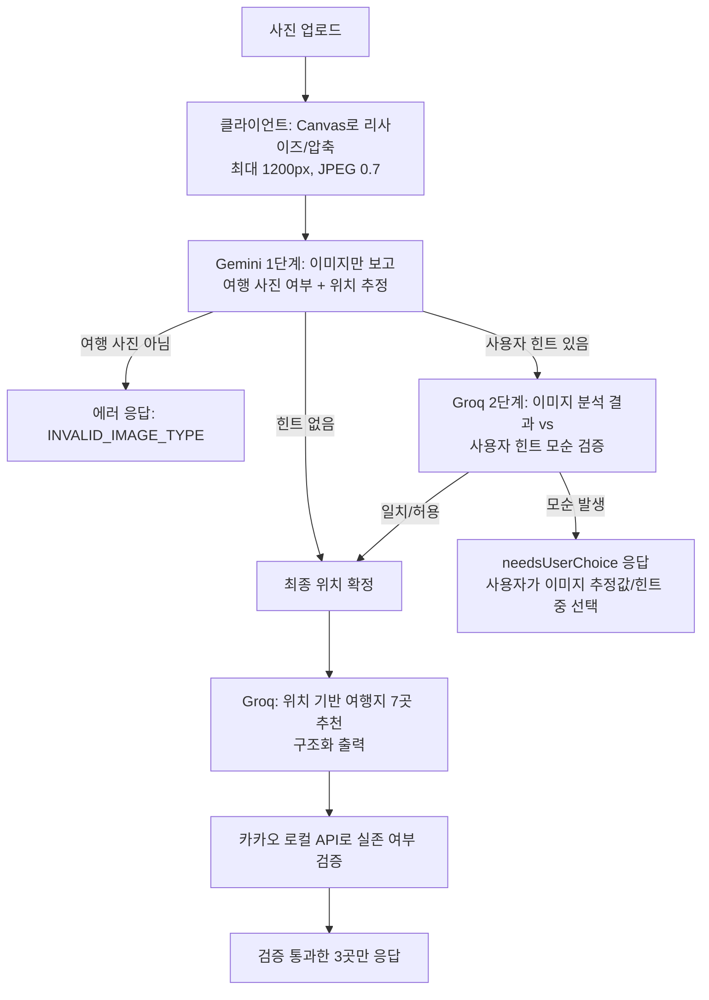

# PicTrip — 사진 기반 여행지 추천 서비스

부트캠프 1차 프로젝트로 3인 팀이 함께 만든 서비스입니다. 사용자가 사진 한 장을 올리면 AI가 촬영 장소/분위기를 추정하고, 그에 맞는 국내 여행지를 추천합니다.

이 문서는 팀원 중 **sangmin**이 담당한 "이미지 분석 → AI 추천" 파이프라인을 중심으로 정리했습니다.

## 담당 역할 (sangmin — 이미지 기반 여행지 추천 기능)

- 사진 업로드 → Gemini 이미지 분석 → Groq 기반 여행지 추천으로 이어지는 API 전체 구현 (`server/controllers/imageAnalyzeController.js`, `server/routes/imageAnalyzeRoutes.js`)
- Groq 호출 실패 시 다른 모델로 자동 전환되는 fallback 로직 작성
- 카카오 로컬 API를 이용해 AI가 지어낸(실존하지 않는) 장소를 걸러내는 1차 검증 로직 작성 (`server/ai/kakaoLocalClient.js`)
- 이미지-사용자 힌트가 모순될 때 사용자가 직접 선택하게 만드는 UX/서버 로직 설계
- 클라이언트 이미지 압축, 타임아웃 처리, AI 응답 JSON 파싱 안정화

## 기술 스택


## 아키텍처 / 요청 흐름



## 핵심 구현 내용

### 1. Gemini → Groq 2단계 추천 파이프라인

`analyzeAndVerifyLocation` 함수(`server/controllers/imageAnalyzeController.js`)가 핵심입니다.

- **1단계 (Gemini, `gemini-3.1-flash-lite`)**: 이미지만 보고 `is_travel_image`(여행 사진 여부), `sido`/`sigungu`/`spot_name`, `confidence`를 Zod 스키마(`StructuredOutputParser`)로 강제해 JSON으로 받습니다. 여행 사진이 아니면 바로 `INVALID_IMAGE_TYPE`으로 거릅니다.
- **2단계 (Groq)**: 사용자가 힌트 텍스트를 입력한 경우에만 실행됩니다. "이미지 분석 결과"와 "사용자 힌트"를 함께 주고, 둘이 확정적으로 모순되는지만 판단하게 했습니다. 프롬프트에 "사용자가 의문문을 쓰거나 모호한 단서만 준 경우에는 모순이 아니다"라는 규칙을 명시해, 힌트 때문에 이미지 기반 결과가 엉뚱하게 바뀌는 것을 막았습니다.
- 추천 단계(`recommendTravelPlace`)는 확정된 위치를 받아 Groq에 7곳을 추천받고, `withStructuredOutput(recommendationSchema)`로 `{ name, region, reason }` 배열을 강제합니다.

### 2. Groq 호출 실패 시 자동 모델 대체(fallback)

Groq API가 간헐적으로 실패하는 문제를 해결하기 위해, 검증 단계와 추천 단계 모두 동일한 패턴을 사용합니다.

```js
try {
  // 1차 시도: Llama 3.3 (llama-3.3-70b-versatile)
  step2Response = await withTimeout(groq.invoke([...]), 20000);
} catch (groqError) {
  console.warn("⚠️ Groq Llama 호출 실패, gpt-oss-120b로 fallback 진행:", groqError.message);
  try {
    // 2차 시도 (Fallback): GPT-OSS-120B (openai/gpt-oss-120b)
    step2Response = await withTimeout(groqFallback.invoke([...]), 20000);
  } catch (fallbackError) {
    throw fallbackError;
  }
}
```

- 1차 모델(`llama-3.3-70b-versatile`)이 타임아웃(20초)이나 에러로 실패하면, 2차 모델(`openai/gpt-oss-120b`)로 즉시 재시도합니다.
- 추천 단계(`recommendTravelPlace`)에서도 동일하게 fallback하고, 두 모델이 모두 실패하면 `fallbackRecommendation`(대한민국 기본 추천)으로 안전하게 대체합니다.
- 위치 분석 자체도 결과가 불확실하면(`findLocation`) 최대 3회까지 재시도하면서, 재시도마다 "지형/건축물/식생/기후 단서를 더 보수적으로 판단하라"는 보강 힌트를 프롬프트에 누적해 넣습니다.

### 3. 카카오 로컬 API를 이용한 "AI가 지어낸 장소" 문제 해결

LLM이 그럴듯하지만 실존하지 않는 장소명을 만들어내는 환각(hallucination) 문제가 있었습니다(`fix: 추천 여행지 환각 현상 해결`, `fix: 환각현상 추가수정 및 카카오 로컬 검증 메서드 작성` 커밋). 이를 2단계로 완화했습니다.

- **프롬프트 레벨**: `buildLocationRecommendPrompt`에 "지도 앱에 검색 가능한 실제 상호명만 사용", "명칭을 임의로 축약하지 말 것(반월호 → 반월호수)", "공공 행정기관 제외" 등 세부 규칙과 출력 전 자가검증 체크리스트를 명시했습니다.
- **코드 레벨 검증 (`verifyPlaceWithKakao`, `server/ai/kakaoLocalClient.js`)**: Groq가 추천한 장소명을 카카오 로컬 API(`keyword.json`)로 실제 검색해, 장소명이 포함 관계로 일치하고 추천한 행정구역과 주소가 맞는 경우에만 통과시킵니다. 검증을 통과한 장소가 3곳이 모일 때까지만 순회하며(`getVerifiedRecommendation`), 통과하지 못한 장소는 최종 응답에서 제외됩니다.

### 4. 이미지-힌트 모순 시 사용자 선택 UX

이미지 분석 결과와 사용자가 입력한 텍스트 힌트가 서로 다른 장소를 가리킬 때, 서버가 일방적으로 한쪽을 선택하지 않고 `needsUserChoice: true`와 함께 "이미지 기반 추정값"과 "힌트 기반 추정값"을 함께 내려줍니다. 프론트(`image-location-analyze.js`)는 이를 받아 사용자가 둘 중 하나를 고르는 UI를 띄우고, 선택 결과를 `/confirm-location`으로 다시 보내 추천을 이어갑니다.

### 5. 클라이언트 이미지 압축 / 응답 안정화

- 업로드 즉시 Canvas로 긴 변 1200px, JPEG 품질 0.7로 리사이즈해 base64 페이로드 크기와 Gemini 응답 시간을 줄였습니다.
- 모든 AI 호출에 20초 타임아웃(`withTimeout`)을 걸어 응답이 없을 때 무한 대기하지 않도록 했습니다.
- `extractJson`으로 코드블록(```json```)이나 잡텍스트가 섞인 LLM 응답에서 JSON 부분만 추출하고, 파싱 실패 시에도 기본값으로 안전하게 대체(graceful fallback)해 요청 전체가 실패하지 않도록 했습니다.

## 트러블슈팅

커밋 이력 기준으로 실제 겪은 문제와 해결 과정입니다.

- **추천 장소 환각 문제**: Groq가 실존하지 않거나 미사여구로 꾸민 장소를 추천 → 프롬프트에 금지 규칙/자가검증 체크리스트 추가 + 카카오 로컬 API로 실존 여부를 재검증하는 로직을 별도로 작성 (`d370027`, `84ed011`).
- **AI 추천 장소명과 카카오맵 검색 결과 불일치**: 공식 명칭 축약(예: "반월호" → "반월호수")으로 카카오 지도 검색이 실패하는 사례 발생 → 프롬프트에 정식 풀네임 사용 규칙과 축약 금지 예시를 명시 (`5f9c960`).
- **타임아웃 및 AI JSON 응답 파싱 실패**: LLM이 JSON 외의 텍스트를 섞어 반환하거나 응답이 지연되는 문제 → `withTimeout`으로 20초 제한, `extractJson`으로 코드블록/잡텍스트에서 JSON만 추출하도록 개선 (`a65b246`).
- **위치기반 분석 AI 신뢰도 버그**: 이미지 분석 결과의 confidence가 낮아도 그대로 확정해버리는 문제 → `findLocation`에서 결과가 불확실하면 최대 3회까지 재분석하며 프롬프트에 보수적 판단 힌트를 누적 (`901d9e9`).
- **Groq 단일 모델 의존 시 호출 실패**: Groq API가 간헐적으로 실패 → `llama-3.3-70b-versatile` 실패 시 `openai/gpt-oss-120b`로 자동 전환하는 fallback 추가 (`348a5b0`).
- **이미지-힌트 모순을 서버가 임의로 판단하는 문제**: 사용자가 애매한 힌트를 줬을 때 서버가 한쪽으로 단정해 오답을 주는 경우 발생 → 모순이 확정적일 때만 선택 UI를 띄우고, 애매한 경우(의문문, 포괄적 단서)는 이미지 분석 결과를 우선하도록 프롬프트 규칙을 구체화 (`a504a6d`).

## 실행 방법

```bash
npm install
npm run dev   # nodemon으로 server/app.js 실행
# 또는
npm start
```

`.env`에 `GOOGLE_API_KEY`(또는 `GEMINI_API_KEY`), `GROQ_API_KEY`, `KAKAO_REST_API_KEY`, Supabase 관련 키가 필요합니다.
