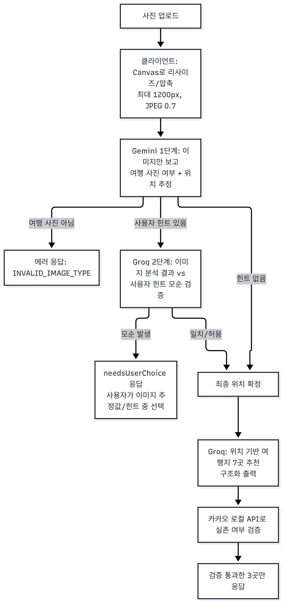
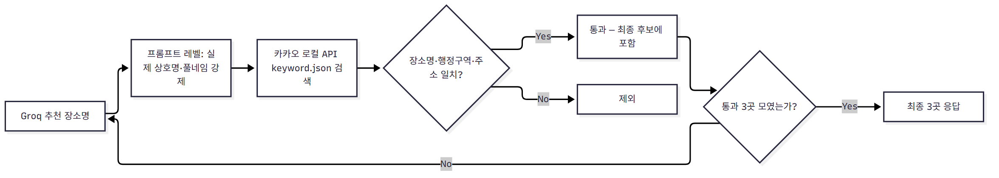

# PicTrip — 사진 기반 여행지 추천 서비스

부트캠프 1차 프로젝트로 3인 팀이 함께 만든 서비스입니다. 사용자가 사진 한 장을 올리면 AI가 촬영 장소/분위기를 추정하고, 그에 맞는 국내 여행지를 추천합니다.

이 문서는 팀원 중 **sangmin**이 담당한 "이미지 분석 → AI 추천" 파이프라인을 중심으로 정리했습니다.

## 한눈에 보기

| 항목 | 내용 |
| --- | --- |
| 서비스 | 사진 한 장으로 촬영 장소/분위기를 추정해 국내 여행지 추천 |
| 팀 구성 | 3인 (부트캠프 1차 프로젝트) |
| 담당 역할 | 이미지 분석 → AI 추천 파이프라인 전체 |
| 핵심 과제 | LLM 환각(실존하지 않는 장소 추천) 방지, AI 호출 실패 시 안전한 대체 |

## 담당 역할 (sangmin — 이미지 기반 여행지 추천 기능)

| 영역 | 작업 내용 |
| --- | --- |
| API 구현 | 사진 업로드 → Gemini 이미지 분석 → Groq 추천 전체 흐름 (`imageAnalyzeController.js`, `imageAnalyzeRoutes.js`) |
| 안정성 | Groq 호출 실패 시 다른 모델로 자동 전환되는 fallback 로직 |
| 환각 방지 | 카카오 로컬 API로 AI가 지어낸(실존하지 않는) 장소를 걸러내는 1차 검증 (`kakaoLocalClient.js`) |
| UX | 이미지-사용자 힌트가 모순될 때 사용자가 직접 선택하게 하는 서버/UX 로직 |
| 성능·안정화 | 클라이언트 이미지 압축, 타임아웃 처리, AI 응답 JSON 파싱 안정화 |

## 기술 스택


> 로그인/여행 일정 저장에 쓰이는 Supabase 연동은 팀원이 구현한 영역이라 본인이
> 담당한 이미지 분석·추천 파이프라인에서는 사용하지 않아 기술 스택에서 제외했다.

## 아키텍처 / 요청 흐름



## 핵심 구현 내용

### 1. Gemini → Groq 2단계 추천 파이프라인

`analyzeAndVerifyLocation` 함수(`server/controllers/imageAnalyzeController.js`)가 핵심입니다.

| 단계 | 모델 | 역할 |
| --- | --- | --- |
| 1단계 | Gemini (`gemini-3.1-flash-lite`) | 이미지만 보고 `is_travel_image`, `sido`/`sigungu`/`spot_name`, `confidence`를 Zod 스키마(`StructuredOutputParser`)로 강제해 JSON으로 받음. 여행 사진이 아니면 `INVALID_IMAGE_TYPE`으로 즉시 거름 |
| 2단계 (선택) | Groq | 사용자가 힌트 텍스트를 입력한 경우에만 실행. 이미지 분석 결과와 사용자 힌트가 **확정적으로 모순**되는지만 판단 |
| 추천 단계 | Groq | 확정된 위치로 7곳 추천, `withStructuredOutput(recommendationSchema)`로 `{ name, region, reason }` 배열 강제 |

> 2단계 프롬프트에는 "사용자가 의문문을 쓰거나 모호한 단서만 준 경우에는 모순이 아니다"라는 규칙을 명시해, 힌트 때문에 이미지 기반 결과가 엉뚱하게 바뀌는 것을 막았다.

### 2. Groq 호출 실패 시 자동 모델 대체(fallback)

Groq API가 간헐적으로 실패하는 문제를 해결하기 위해, 검증 단계와 추천 단계 모두 동일한 패턴을 사용합니다.

```js
try {
  // 1차 시도: Llama 3.3 (llama-3.3-70b-versatile)
  step2Response = await withTimeout(groq.invoke([...]), 20000);
} catch (groqError) {
  console.warn("⚠️ Groq Llama 호출 실패, gpt-oss-120b로 fallback 진행:", groqError.message);
  try {
    // 2차 시도 (Fallback): GPT-OSS-120B (openai/gpt-oss-120b)
    step2Response = await withTimeout(groqFallback.invoke([...]), 20000);
  } catch (fallbackError) {
    throw fallbackError;
  }
}
```

| 단계 | 동작 |
| --- | --- |
| 1차 실패 | `llama-3.3-70b-versatile`이 타임아웃(20초)·에러 시 2차 모델로 즉시 재시도 |
| 2차 모델 | `openai/gpt-oss-120b` — 추천 단계(`recommendTravelPlace`)도 동일 패턴 |
| 전체 실패 | 두 모델 모두 실패하면 `fallbackRecommendation`(대한민국 기본 추천)으로 안전 대체 |
| 위치 분석 재시도 | `findLocation` 결과가 불확실하면 최대 3회 재시도, 매번 "지형/건축물/식생/기후 단서를 더 보수적으로 판단하라"는 보강 힌트 누적 |

### 3. 카카오 로컬 API를 이용한 "AI가 지어낸 장소" 문제 해결

LLM이 그럴듯하지만 실존하지 않는 장소명을 만들어내는 환각(hallucination) 문제가 있었습니다(`fix: 추천 여행지 환각 현상 해결`, `fix: 환각현상 추가수정 및 카카오 로컬 검증 메서드 작성` 커밋). 이를 2단계로 완화했습니다.



| 레벨 | 내용 |
| --- | --- |
| 프롬프트 | `buildLocationRecommendPrompt`에 "지도 앱에 검색 가능한 실제 상호명만 사용", "명칭 임의 축약 금지(반월호 → 반월호수)", "공공 행정기관 제외" 등 세부 규칙과 출력 전 자가검증 체크리스트 명시 |
| 코드 검증 | `verifyPlaceWithKakao`(`kakaoLocalClient.js`)가 카카오 로컬 API(`keyword.json`)로 실제 검색, 장소명 포함 관계 + 행정구역·주소 일치 시에만 통과 |
| 수집 방식 | `getVerifiedRecommendation`이 통과한 장소가 3곳 모일 때까지만 순회, 미통과 장소는 최종 응답에서 제외 |

### 4. 이미지-힌트 모순 시 사용자 선택 UX

이미지 분석 결과와 사용자가 입력한 텍스트 힌트가 서로 다른 장소를 가리킬 때, 서버가 일방적으로 한쪽을 선택하지 않고 `needsUserChoice: true`와 함께 "이미지 기반 추정값"과 "힌트 기반 추정값"을 함께 내려줍니다. 프론트(`image-location-analyze.js`)는 이를 받아 사용자가 둘 중 하나를 고르는 UI를 띄우고, 선택 결과를 `/confirm-location`으로 다시 보내 추천을 이어갑니다.

### 5. 클라이언트 이미지 압축 / 응답 안정화

- 업로드 즉시 Canvas로 긴 변 1200px, JPEG 품질 0.7로 리사이즈해 base64 페이로드 크기와 Gemini 응답 시간을 줄였습니다.
- 모든 AI 호출에 20초 타임아웃(`withTimeout`)을 걸어 응답이 없을 때 무한 대기하지 않도록 했습니다.
- `extractJson`으로 코드블록(```json```)이나 잡텍스트가 섞인 LLM 응답에서 JSON 부분만 추출하고, 파싱 실패 시에도 기본값으로 안전하게 대체(graceful fallback)해 요청 전체가 실패하지 않도록 했습니다.

## 실제 사용한 프롬프트

`server/controllers/imageAnalyzeController.js`에 작성한 프롬프트 원문이다(`server/ai/aiClient.js`의
여행 일정 생성용 프롬프트는 팀원 영역이라 제외).

### 1단계 — 이미지만으로 위치 추정 (Gemini)

```text
당신은 이미지 분석 전문가입니다. 주어진 사진만 보고 촬영된 여행지를 추정하세요.
텍스트 힌트보다 이미지의 시각적 단서가 무조건 1순위 우선순위를 가진다.

⚠️ [매우 중요] 만약 이미지가 여행지나 풍경 사진이 아니고, 인터넷 웹사이트 스크린샷, 컴퓨터 UI, 글자만 있는 문서, 혹은 장소를 알 수 없는 단순 사물(예: 키보드, 볼펜 등)인 경우 'is_travel_image'를 반드시 false로 설정하세요.

반드시 설명 없이 주어진 JSON 스키마 형식으로만 반환하세요.
{format_instructions}
```

### 2단계 — 이미지 분석 결과 vs 사용자 힌트 모순 검증 (Groq)

```text
당신은 데이터 검증 전문가입니다. 
[사진 분석 결과]의 물리적 장소와 사용자가 입력한 [사용자 입력 힌트]를 비교하여, 두 정보가 '확정적으로 모순'되는지 검증하세요.

[사진 분석 결과]: {detectedLocation}
[사용자 입력 힌트]: {userHint}

⚠️ [판정 및 검증 규칙 - 필수 준수]

1. 명백한 모순 (is_matching: false 조건):
   - 이미지 속 실제 위치와 사용자가 '확정적인 어조'로 주장하는 공간적 위치/지역이 완전히 다를 때만 false로 판정합니다.
   - 예시: [사진 분석 결과]가 '63빌딩'인데 힌트가 '제주도에서 찍음'인 경우 (확정적 거짓/모순이므로 false)

2. 모순이 아닌 허용 케이스 (is_matching: true 조건 - 매우 중요):
   - 추측 및 의문문: 사용자가 "~인가? 아닌가?", "어디였지? 기억이 안 나네" 처럼 확신이 없거나 헷갈려하는 표현을 쓴 경우 모순이 아닙니다. 유저는 정답을 모르고 있으므로 힌트를 무시하고 'is_matching'을 true로 처리하세요.
   - 포괄적/모호한 단서: "드라마 촬영지", "호수공원", "이쁜 카페" 처럼 전국 어디에나 해당할 수 있는 넓은 범위의 단서를 준 경우, 이미지 결과와 충돌하지 않으므로 모순이 아닙니다. 'is_matching'을 true로 처리하세요.
   - 유도 신문 방지: 모호한 단서("드라마 촬영지") 때문에 [사진 분석 결과](동탄호수공원)를 엉뚱한 다른 유사 장소(일산호수공원)로 왜곡하거나 상상하여 바꾸지 마십시오. 시각적 단서 기반인 [사진 분석 결과]가 무조건 최우선 가중치를 가집니다.

3. final_location 작성 규칙:
   - 'is_matching'이 true이면서 유저가 헷갈려하는 경우(예: "부산인가? 다른 데인가?"): 유저 힌트를 무시하고 [사진 분석 결과] 명칭을 그대로 final_location에 작성하세요.
   - 'is_matching'이 true이면서 유저 힌트가 정확한 단서인 경우: 두 정보를 조합하여 가장 정확한 풀네임을 완성하세요.
   - 'is_matching'이 false인 경우(모순): 사용자의 힌트는 거짓 정보이므로 전달받은 [사진 분석 결과]의 명칭을 토대로 최종 위치를 강제 고정하세요.

4. hint_based_location 작성 규칙:
   - is_matching 값과 무관하게, [사진 분석 결과]는 완전히 배제하고 [사용자 입력 힌트]만 근거로 작성하세요.
   - 힌트 문장 안에 지명(시/도, 시/군/구, 동/읍/면, 랜드마크 등)이 포함되어 있다면, 그것을 정식 행정구역명 또는 명소명으로 정리해서 적으세요. (예: "제주에서찍음" -> "제주특별자치도", "목포에서 찍은사진이야" -> "전라남도 목포시")
   - 힌트에 지명 정보가 전혀 없다면(예: "바다", "예쁜 카페") 빈 문자열("")로 두세요.

반드시 설명 없이 주어진 JSON 스키마 형식으로만 응답하세요.
{format_instructions}
```

### 추천 단계 — 위치 기반 여행지 7곳 추천 (Groq, 환각 방지 규칙 포함)

```text
추정 위치:
{region}

당신은 대한민국 최고의 국내 여행 가이드입니다.
제시된 조건을 바탕으로, 카카오맵/네이버 지도에서 '실제 검색 및 위치 조회가 가능한' 한국의 구체적인 여행지 7곳을 추천해 주세요.

⚠️ [필수 준수 규칙 - 위반 시 에러]
1. 존엄성 및 실존 주의:
   - 절대로 가상의 장소, 미사여구로 꾸며낸 장소를 지어내지 마십시오. (X: "낭만적인 부산 밤바다 거리", "조용한 제주 돌담길")
   - 반드시 지도 앱에 등록되어 있는 실제 상호명, 공공 관광지명, 명소 고유 명사만 사용하십시오. (O: "광안리해수욕장", "감천문화마을", "신창풍차해안도로")

2. 추천 단위 제한:
   - "부산 영도구", "제주 서귀포시" 같은 행정구역 자체를 name에 넣지 마십시오. 반드시 구체적인 명소여야 합니다.

3. 데이터 매핑 규칙:
   - "name": 지도 앱에 검색할 '최종 목적지 고유 명칭'만 명확히 작성 (예: "해운대 블루라인파크")
   - "region": 해당 명소가 위치한 '시/도 + 시/군/구'까지 정확한 행정구역 작성 (예: "부산광역시 해운대구")
   - "reason": 왜 이 장소를 추천하는지 이유를 간결하게 작성해 주세요

4. 명소 명칭의 무단 축약 및 변형 금지 (매우 중요):
- 인터넷 검색 및 지도 앱에 등록된 '정식 풀네임(Official Full Name)'을 그대로 적으십시오.
- 접미사(호수, 저수지, 해수욕장, 평야, 생태공원 등)를 절대로 마음대로 생략하거나 축약하지 마십시오.
- 예시 오류 교정:
  * (X) 반월호 -> (O) 반월호수
  * (X) 백운호 -> (O) 백운호수
  * (X) 광안리 -> (O) 광안리해수욕장
  * (X) 일산공원 -> (O) 일산호수공원
- 지형이나 상호명의 끝 글자 하나가 달라지면 지도 API가 장소를 찾지 못하므로, 반드시 정확한 풀네임인지 검증 후 출력하세요.

5. 국가 및 행정 기관 건물 추천 배제 (매우 중요):
   - 순수한 관광 목적이 아닌 공공 행정 기관, 국가 건물, 지방 자치 단체 청사는 **절대로** 추천하지 마십시오.
   - 예시 오류 교정: (X) 서울시청, 부산시청, 제주도청, 종로구청, 울릉군청 등 모든 형태의 시청/도청/구청/군청/주민센터/정부청사 및 법원 등 공공 업무 시설은 제외합니다. 다만, 역사적 가치가 있어 관광지화된 장소(예: '구 서울역사', '덕수궁 석조전')는 허용됩니다.

출력 전 반드시 자가검증:
- [ ] 이 장소를 카카오맵에 검색하면 나오는가?
- [ ] 공식 명칭 전체를 사용했는가?
- [ ] 미사여구나 수식어가 name 필드에 없는가?
검증 실패 시 다른 장소로 교체할 것.

반드시 아래 JSON 포맷 표준을 준수하여 JSON 데이터만 반환하세요. 다른 텍스트는 절대 포함하지 마십시오.

{
  "spots": [
    {
      "name": "명소 고유 명칭",
      "region": "행정구역명",
      "reason": "추천 사유 설명"
    }
  ]
}
```

## 트러블슈팅

커밋 이력 기준으로 실제 겪은 문제와 해결 과정입니다.

| 문제 | 원인 | 해결 | 커밋 |
| --- | --- | --- | --- |
| 추천 장소 환각 | Groq가 실존하지 않거나 미사여구로 꾸민 장소 추천 | 프롬프트에 금지 규칙·자가검증 체크리스트 추가 + 카카오 로컬 API로 실존 여부 재검증 로직 작성 | `d370027`, `84ed011` |
| AI 추천 장소명 ↔ 카카오맵 검색 불일치 | 공식 명칭 축약(예: "반월호" → "반월호수")으로 카카오 지도 검색 실패 | 프롬프트에 정식 풀네임 사용 규칙과 축약 금지 예시 명시 | `5f9c960` |
| 타임아웃·AI JSON 파싱 실패 | LLM이 JSON 외 텍스트를 섞어 반환하거나 응답 지연 | `withTimeout`으로 20초 제한, `extractJson`으로 코드블록/잡텍스트에서 JSON만 추출 | `a65b246` |
| 위치 분석 신뢰도 버그 | confidence가 낮아도 그대로 확정 | `findLocation`에서 불확실하면 최대 3회 재분석, 프롬프트에 보수적 판단 힌트 누적 | `901d9e9` |
| Groq 단일 모델 의존 시 호출 실패 | Groq API 간헐적 실패 | `llama-3.3-70b-versatile` 실패 시 `openai/gpt-oss-120b`로 자동 전환하는 fallback 추가 | `348a5b0` |
| 이미지-힌트 모순을 서버가 임의 판단 | 애매한 힌트에도 서버가 한쪽으로 단정해 오답 | 모순이 확정적일 때만 선택 UI, 애매한 경우(의문문·포괄 단서)는 이미지 분석 결과 우선하도록 프롬프트 구체화 | `a504a6d` |

## 실행 방법

```bash
npm install
npm run dev   # nodemon으로 server/app.js 실행
# 또는
npm start
```

`.env`에 `GOOGLE_API_KEY`(또는 `GEMINI_API_KEY`), `GROQ_API_KEY`, `KAKAO_REST_API_KEY`, Supabase 관련 키가 필요합니다.
